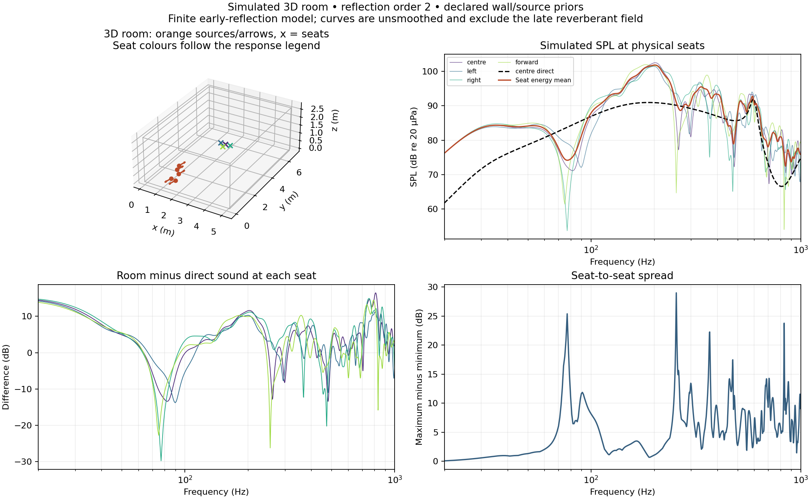

# room_response: 3D room and listening-position response

Adds rectangular-room reflections to a complete simulated speaker. It imports the same section, crossover, baffle and outlet files used by `whole_speaker`, places their acoustic centres in a room and computes complex pressure at each listening position. No extra package is needed beyond the framework environment.

```sh
.speaker-venv/bin/python framework/tools/run_simulation.py room_response --input framework/simulations/room_response/example.json --out /private/tmp/room-example --name room
```

Run the normal example chain first to create this example's referenced source files. For a project, point `speaker_file` at the frozen whole-speaker **parameter** document, not its result. The imported document's own relative references resolve in its directory.

## Geometry and input

Room coordinates are metres, with walls at zero and at each dimension: x across, y forward, z up. Speaker local coordinates follow `whole_speaker`: x lateral, y forward from the front baffle, z height; acoustic depth is negative y. `origin_m` translates that datum, including the existing cabinet floor offset. `yaw_deg` rotates local forward +y toward room +x for positive angles. Driver tilt and rear-outlet orientation are preserved. Room dimensions, source acoustic centres and receivers must be physically valid; the acoustic centres and receivers must be strictly inside the room. The origin can lie on the floor.

| Input | Meaning |
|---|---|
| `frequencies` | Default 20–2000 Hz in 1 Hz steps; dense linear grids resolve reflection combs better than sparse log grids |
| `room.dimensions_m` | `[width, depth, height]` |
| `room.pressure_reflection` | Exactly `x_min`, `x_max`, `y_min`, `y_max`, `z_min`, `z_max`; each a signed pressure coefficient in [-1,1], or `{"points": [[frequency_hz, coefficient], ...]}` |
| `max_order` | Total wall-hit count, 0–8; default 2; finite early-reflection truncation, not an infinite reverberant solution |
| `speakers[]` | Each has `name`, `origin_m`, optional `yaw_deg`, `input_voltage_rms`, and exactly one of `speaker_file` or inline `speaker` |
| `speakers[].rear_radiation` | Optional fallback for imported sources lacking a rear prior; same `shadowed_monopole` fields as `whole_speaker` |
| `receivers[]` | `name` and `position_m` for each seat or spatial sample |

Voltage defaults to the imported parameter document's input voltage, then 2.83 V. Multiple speakers reproduce the same coherent input; independent stereo channels are not modeled. An omni source is full-sphere. Other directivity types require a declared rear prior so wall-facing rays do not silently disappear. Choose those priors by source type and compare alternatives when they influence the result.

Pressure reflection is **not** energy absorption. For an ideal nontransmitting boundary with a real positive reflection coefficient, `r = sqrt(1 - alpha)`; a random-incidence absorption catalogue is not automatically the correct specular coefficient. Frequency tables are interpolated in log frequency and must cover the requested band. Imported source, transfer and baffle curves must cover it too; this app rejects endpoint extrapolation.

The imported `floor` and `observer` blocks are not used: room receivers and room floor reflections replace them. Do not pre-apply a room/floor correction to the imported source curves. On-axis baffle factors are reused for all rays, an explicit approximation that does not constitute angle-dependent diffraction.

## Calculation and output

For each axis an image receiver is `2 n L + (-1)^p r`, where integer `n` and parity `p` enumerate images. Wall-hit counts are `abs(n-p)` at the minimum wall and `abs(n)` at the maximum wall. Keep combinations whose total count is at most `max_order`. Each ray contributes source pressure times its directional gain, the product of wall coefficients, `exp(-j k distance) / distance`. The source curve is Pa/volt at 1 m, so no extra `4 pi` factor is applied. Unfolding receiver coordinates preserves the source's emission direction, including yaw and pitch.

Results include:

- `receivers[].pressure_pa`, `direct_pressure_pa`, `reflected_pressure_pa` and their SPL comparisons. These are actual-position RMS pressures, with full propagation delay; they are **not 1 m equivalent** output from `whole_speaker`.
- `direct_and_first_arrivals`: physical distance, arrival time and wall-hit identity for direct/first-order paths per source. These are geometric arrivals, not a band-limited impulse response.
- `last_order_pressure_pa` and `order_increment_db`: contribution of order N and difference from N-1. A small increment at one order alone does not prove convergence.
- `spatial_summary`: energy-mean SPL, min/max and spread across the declared receivers. Pressures are summed coherently within a seat, not across seats.
- `source_geometry`: transformed positions, axes and directivity priors, usable for drawing the 3D scene.
- `validity`: longest included path and a frequency-step diagnostic for eight samples per longest-path phase cycle. Refine frequency sampling and reflection order separately.

The model excludes furniture, scattering, nonrectangular boundaries, wall vibration, air absorption and source-load changes near walls. Low-order results describe boundary interference; they do not establish modal steady-state bass or RT60. Use [room simulation](../../references/room-simulation.md) to choose scenarios and the next model when one of those mechanisms controls the design. The current app is a useful added physical dimension, not a general 3D wave solver.

## Verification

`framework/tests/test_room_response.py` checks free-field level/delay, distance scaling, a single floor against the existing propagation model, unequal-wall first and second orders, source/receiver reciprocity, directional rotation, frequency-dependent walls, spatial energy averaging, coherent multiple speakers, relative file references, outlet/polarity integration and invalid input domains. These checks validate the equations and conventions implemented here.

## Example scene and response



The figure uses the supplied example and illustrative boundary coefficients. Regenerate it with `framework/tools/plot_room_response.py` from the example result.
